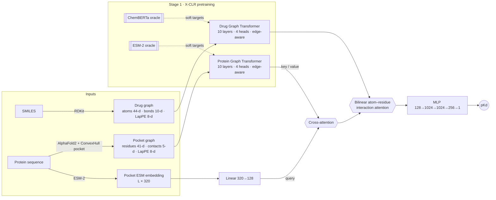
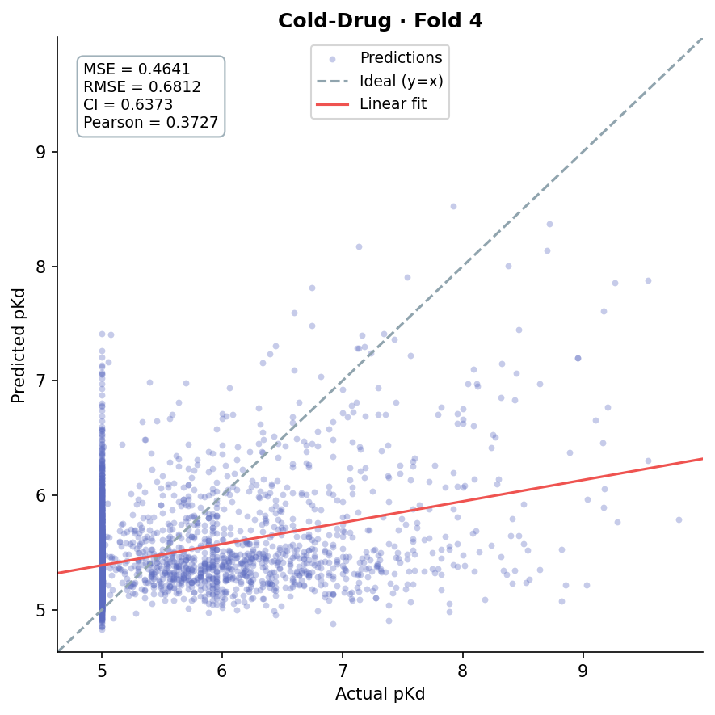
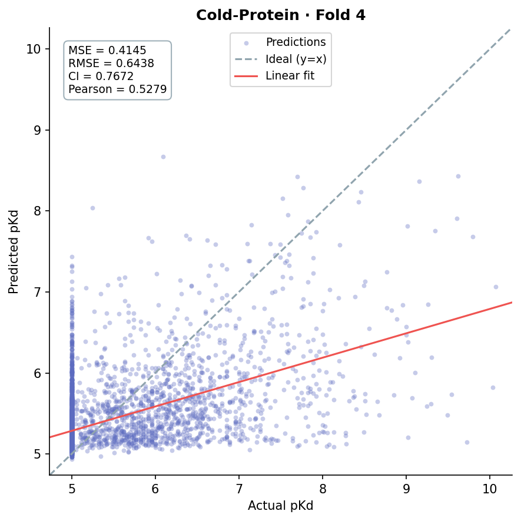
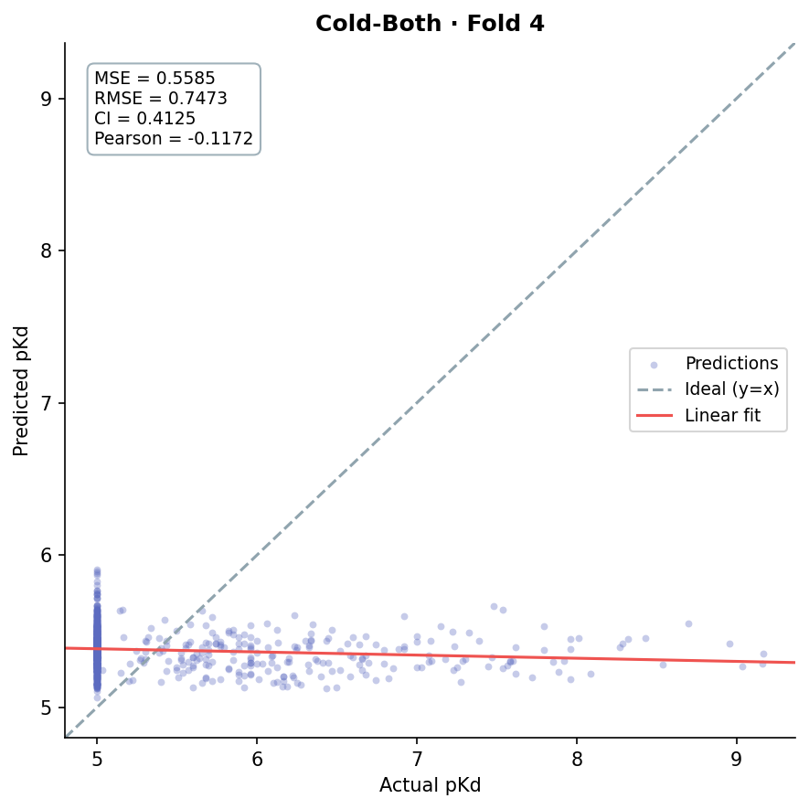

# Cold-Start Drug–Target Affinity Prediction with Contrastive-Pretrained Graph Transformers

**MDGTDTInet** predicts drug–protein binding affinity (pKd) for **drugs and proteins the model has never seen**, the setting that matters in real drug discovery. It uses two stages:

1. **X-CLR contrastive pretraining.** The drug and protein graph-transformer encoders learn similarity structure from frozen foundation-model oracles: ChemBERTa for molecules and ESM-2 for proteins.
2. **Multi-modal affinity learning.** A drug molecular graph, an AlphaFold2 binding-pocket graph and ESM-2 residue embeddings are fused with cross-attention and a bilinear atom–residue interaction map, then regressed to pKd.

On the Davis kinase benchmark with strict entity-level cold-start splits, the model has the **lowest MSE of all compared methods on cold-drug (0.464) and cold-both (0.559)**. On cold-protein it is competitive with the best methods (MSE 0.415, CI 0.767).

> CSE 330 (Machine Learning Sessional), BUET. **Team Perceptron**: 2105022 · 2105023 · 2105024

---

## Architecture



| Component | Details |
|---|---|
| **Graph Transformer encoders** | Edge-modulated multi-head attention: `score = (Q·K/√d) ⊙ W_E·e`, softmax per destination node. Node and edge states are both updated in every layer (residual + LayerNorm + FFN). Separate weights for drug and protein. |
| **X-CLR pretraining** | `L = H(softmax(sim_oracle/τ_s), log_softmax(sim_z/τ))` over off-diagonal pairs, with τ = 0.1 and τ_s = 0.05. Drug similarity comes from ChemBERTa [CLS] cosine and protein similarity from mean-pooled ESM-2 cosine. Only training-split entities are used. |
| **Protein modality fusion** | ESM-2 residue embeddings (what the protein *does*) attend over pocket-graph residue states (how the pocket is *shaped*). |
| **Interaction module** | `σ(W_p·h_p · (W_c·h_d)ᵀ)` gives a normalised atom×residue attention map that pools `tanh(h_p ⊙ h_d)` into a single 128-d pair embedding. |
| **Training** | Stage 1: Adam 3e-4, batch 8 × 4 grad-accum, grad-clip 1.0. Stage 2: MSE loss, Adam 1e-4, ReduceLROnPlateau (0.8, patience 10), batch 32, 30–50 epochs. About 6.2M parameters. |

---

## Results: Davis cold-start benchmark

**Protocol.** 5-fold cross-validation with **entity-level splits** and zero drug/protein overlap between train and test where the scenario requires it. Every split was checked for leakage programmatically. The numbers below are for fold 4.

| Scenario | What's unseen at test time | Test pairs | MSE ↓ | RMSE ↓ | CI ↑ |
|---|---|---:|---:|---:|---:|
| **Cold-drug** | 13 novel drugs × 365 known proteins | 4,745 | **0.464** | 0.681 | 0.637 |
| **Cold-protein** | 68 known drugs × 73 novel proteins | 4,964 | **0.415** | 0.644 | **0.767** |
| **Cold-both** | 13 novel drugs × 73 novel proteins | 949 | **0.559** | 0.747 | 0.413 |

### Comparison with published methods (Davis)

| Model | Cold-drug MSE ↓ | Cold-drug CI ↑ | Cold-protein MSE ↓ | Cold-protein CI ↑ | Cold-both MSE ↓ | Cold-both CI ↑ |
|---|---:|---:|---:|---:|---:|---:|
| DeepDTA | 0.985 | 0.548 | 0.552 | 0.729 | 0.767 | 0.508 |
| AttentionDTA | 0.869 | 0.642 | 0.436 | 0.787 | 0.679 | 0.554 |
| GraphDTA | 0.801 | 0.659 | 0.860 | 0.666 | 0.988 | 0.569 |
| DGraphDTA | 0.818 | 0.646 | 0.445 | 0.788 | 0.658 | 0.569 |
| MGraphDTA | 0.907 | 0.599 | **0.359** | 0.813 | 0.764 | 0.507 |
| HGRL-DTA | 0.776 | **0.684** | 0.383 | 0.816 | 0.642 | 0.602 |
| GAS-DTA | 0.765 | 0.674 | 0.386 | **0.817** | 0.616 | **0.610** |
| **MDGTDTInet (ours)** | **0.464** | 0.637 | 0.415 | 0.767 | **0.559** | 0.413 |

*Baseline numbers are taken from the cold-start benchmark reported in the GAS-DTA paper.*

**Key findings**

- **Cold-drug: lowest MSE of all methods (0.464),** a 39% reduction against the strongest baseline (GAS-DTA, 0.765). X-CLR teaches the drug encoder to place ChemBERTa-similar molecules close together, so unseen scaffolds still get informative embeddings.
- **Cold-both: lowest MSE of all methods (0.559),** a 9% reduction against GAS-DTA (0.616), in the hardest setting where both the drug and the target are novel.
- **Cold-protein: competitive with the best methods** (MSE 0.415, CI 0.767). ESM-2 evolutionary priors combined with structure-aware cross-attention transfer well to new kinases. This is the setting for target-based virtual screening of a known drug library against a new target.

<table>
<tr>
<th align="center">Cold-drug</th><th align="center">Cold-protein</th><th align="center">Cold-both</th>
</tr>
<tr>
<td></td>
<td></td>
<td></td>
</tr>
</table>

Per-pair predictions and full metric files are in [`results/`](results/).

---

## Repository structure

```
├── dta/                        # library code
│   ├── config.py               # paths + hyper-parameters
│   ├── data/
│   │   ├── drug_graph.py       # SMILES → PyG graph (RDKit, Laplacian PE)
│   │   ├── download_af2.py     # AlphaFold DB structure download
│   │   ├── protein_graph.py    # PDB → binding-pocket residue graph (MDAnalysis, DeepChem)
│   │   ├── esm_embed.py        # ESM-2 pocket residue embeddings
│   │   └── dataset.py          # DTADataset + collate
│   ├── models/
│   │   ├── graph_transformer.py
│   │   └── mdgtdti.py          # cross-attention + bilinear interaction + regressor
│   ├── losses.py               # X-CLR soft-target contrastive loss
│   └── metrics.py              # MSE, CI, r²m, Pearson, Spearman
├── scripts/
│   ├── pretrain_xclr.py        # Stage 1
│   ├── train.py                # Stage 2
│   └── evaluate.py             # metrics, predictions.csv, plots
├── app/app.py                  # Streamlit demo
├── data/Davis/splits/          # random / cold_drug / cold_protein / cold_both × 5 folds
├── results/                    # predictions, metrics and plots per scenario
├── notebooks/                  # original exploratory + preprocessing notebooks
└── docs/                       # slides, proposal, architecture diagrams (draw.io)
```

---

## Quick start

```bash
git clone https://github.com/Morningstaaar36/CSE_330_PROJECT.git
cd CSE_330_PROJECT
pip install -r requirements.txt
```

**Processed data and checkpoints.** Download `davis_processed.tar.gz` and `checkpoints.tar.gz` from the [Releases](https://github.com/Morningstaaar36/CSE_330_PROJECT/releases) page and extract both in the repo root. They contain `data/Davis/{drugs,proteins,ESM_embedding_pocket}` and `checkpoints/*.pth`.

```bash
# Evaluate a released checkpoint
python scripts/evaluate.py --scenario cold_drug --fold 4

# Train from scratch
python scripts/pretrain_xclr.py --scenario cold_drug --fold 4   # Stage 1: X-CLR
python scripts/train.py          --scenario cold_drug --fold 4   # Stage 2: affinity

# Interactive demo
streamlit run app/app.py
```

**Rebuilding features from raw data** (requires `Davis_compound_mapping.csv` and `Davis_protein_mapping.csv` in `data/Davis/`):

```bash
python -m dta.data.drug_graph        # drug graphs
python -m dta.data.download_af2      # AlphaFold2 structures
python -m dta.data.protein_graph     # pocket graphs + pocket indices
python -m dta.data.esm_embed         # ESM-2 pocket embeddings
```

---

## Credits

MDGTDTInet and its two-stage training pipeline were designed by Team Perceptron. We build on and cite the following work:

- **AttentionMGT-DTA**: H. Wu *et al.*, "A multi-modal drug-target affinity prediction using graph transformer and attention mechanism", *Neural Networks* 169 (2024) 623–636.
- **X-CLR**: V. Sobal *et al.*, "X-Sample Contrastive Loss: Improving Contrastive Learning with Sample Similarity Graphs", 2024.
- **ESM-2**: Z. Lin *et al.*, "Evolutionary-scale prediction of atomic-level protein structure with a language model", *Science* 2023.
- **ChemBERTa**: S. Chithrananda *et al.*, "ChemBERTa: Large-Scale Self-Supervised Pretraining for Molecular Property Prediction", 2020.
- **Graph Transformer**: V. P. Dwivedi and X. Bresson, "A Generalization of Transformer Networks to Graphs", 2020.
- **Davis dataset**: M. I. Davis *et al.*, *Nature Biotechnology* 29 (2011). Structures from the **AlphaFold Protein Structure Database**; pocket detection with **DeepChem**.
